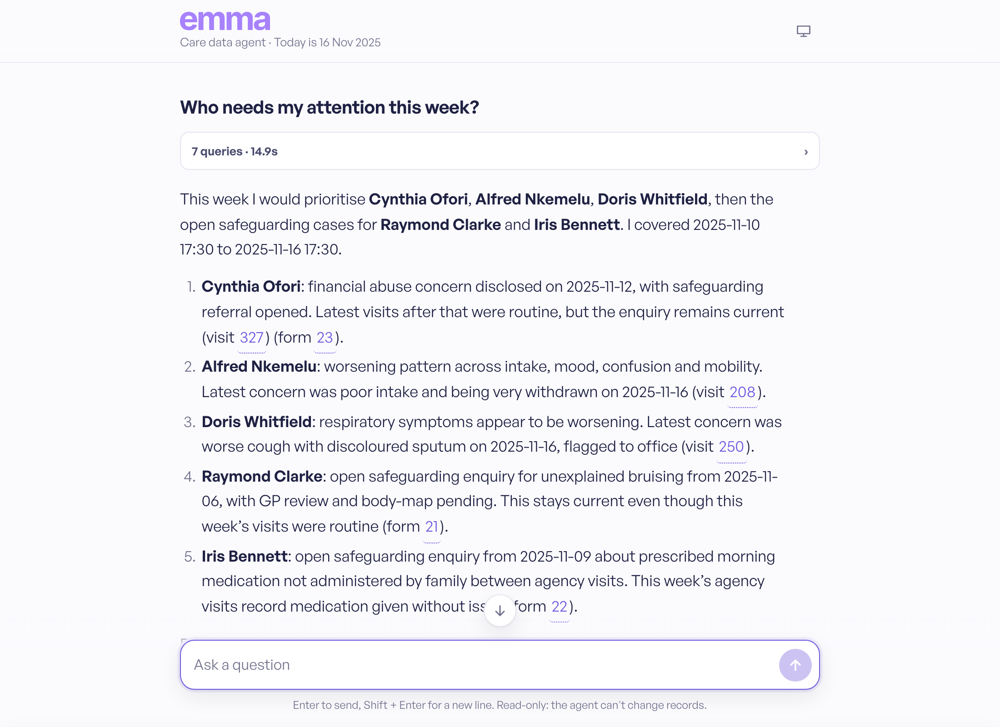
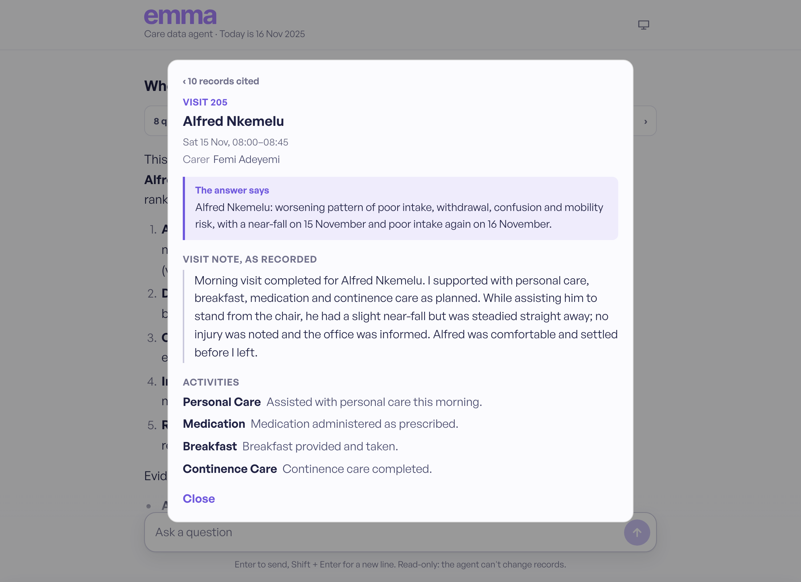
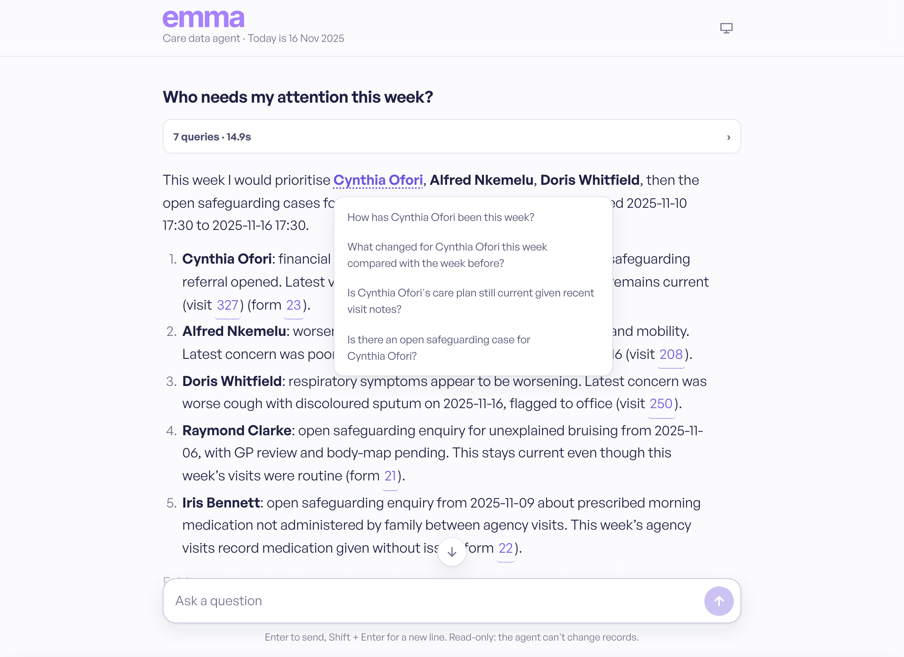
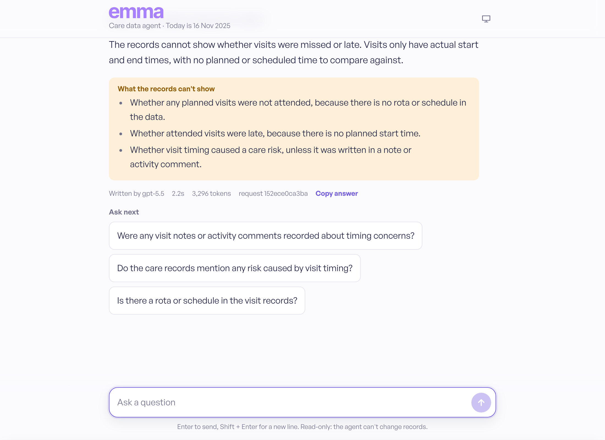
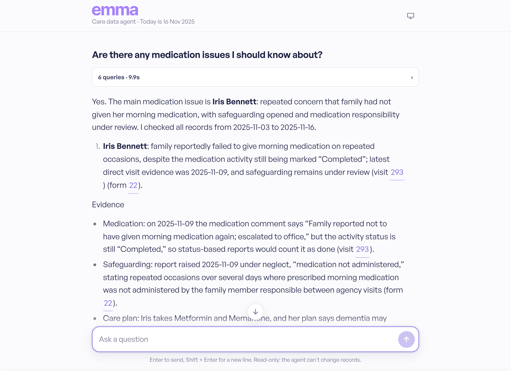
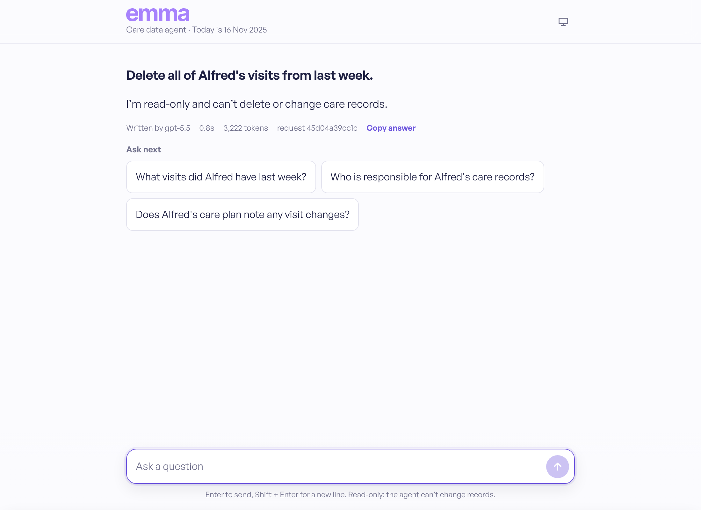
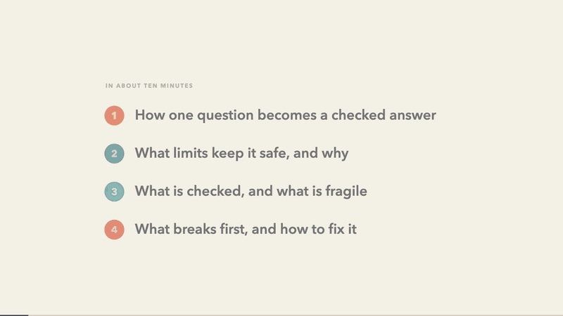

# Care data agent

Ask a home-care provider's data a question in plain English. An AI agent writes read-only SQL, reads the
notes it found, answers with a citation for every claim, and says what the records can't show.

```bash
uv sync
uv run uvicorn app.server:app      # open http://localhost:8000
```

That is all. With no API key it plays back real recorded answers for the five example questions.
To ask anything else, copy `.env.example` to `.env` and set `OPENAI_API_KEY`.

**Where to go next:** [START_HERE.md](START_HERE.md) is the reading order and code map.
[docs/journey.html](docs/journey.html) is the full story: every decision, its evidence and trade-off.
[DEMO.md](DEMO.md) is a ten-minute talk track.

## What it does

| | |
|---|---|
| **Happy path.** Ask who needs attention. Each claim cites a record you can open. |  |
| **Check the source.** Tap a citation to see the carer's own note next to the claim. |  |
| **Follow up.** Tap a name for four fixed questions about that person. |  |
| **Honest negative.** Visits have no planned times, so it says late and missed can't be measured. |  |
| **Trap.** A visit marked Completed whose note says the medication wasn't given. A report built on status would miss it. |  |
| **Refusal.** It is read-only, and the database refuses writes whatever the model says. |  |

The same agent runs in the terminal: `uv run python -m app.agent "Who needs my attention this week?"`

## One question, in a straight line



[Step through it yourself](docs/flow.html) (open the file in a browser; each step also says what breaks first as data or people grow), or [watch the narrated 11-minute film](docs/media/flow.mp4) (how it works, every limit and why, what is checked, what breaks first and the fix for each). To validate it with real care managers, see [the one-page protocol](docs/manager-protocol.md).

1. You type a question and the page sends it (`app/static/app.js`).
2. The server checks it, gives it a request id and starts the agent (`app/server.py`).
3. The agent sends the model the question plus a prompt that already holds the schema, the people and a glossary (`app/agent.py`, `app/schema.py`).
4. The model calls its one tool, `run_sql`, up to 8 times, reading each result before the next query.
5. Each query runs read-only, with caps on rows, size and time (`app/db.py`).
6. The answer streams back as lines of JSON: queries, results, then text word by word (`app/events.py`).
7. The page writes the text as it arrives, turns every `(visit 12)` into a button and every name into a link, and opens the record behind a button when tapped (`app/static/app.js`, `app/records.py`).

**How step 7 works.** Every row the model reads carries the id of its record. The prompt asks it to write ids in one exact form: `(visit 12)`, `(form 4)`, `(visits 12, 15)`. The page escapes the text, then one pattern swaps each match for a button holding the kind and id. A tap fetches that record from `/api/records/...` and shows it beside the sentence of the answer it supports. A citation that doesn't match stays plain text, so mistakes are visible. Evals fail on a citation the page can't link or an id that doesn't exist. Not checked: that the record supports the sentence. The full chain is in the journey page, "How citations work, end to end".

## Settings

| Setting | Default | Effect |
|---|---|---|
| `OPENAI_API_KEY` | none | Set: live mode. Unset: replay mode. |
| `CARE_AGENT_MODE` | auto | Force `live` or `replay`. |
| `OPENAI_MODEL` / `FOLLOW_UP_MODEL` | gpt-5.5 / gpt-5.4-mini | Answering and follow-up models. |
| `OPENAI_REASONING_EFFORT` | `none` | Thinking time per turn. `none` is about 3x faster and passes the same evals; empty leaves it to the model. |
| `CARE_LOG_CONTENT` | off | `1` logs questions and SQL, which can name people. |
| `CARE_DB` | `sources/care_data.db` | The database to query. |

## How it works

```
page ──POST /api/ask/stream──▶ FastAPI ──▶ agent loop (OpenAI tool calling)
                                       │  system prompt = strategy + schema derived from the live DB
                                       └─ run_sql(sql, params) ──▶ SQLite, read-only
```

**The core idea:** SQL narrows the data, the model reads what was narrowed, and the answer
says what it can't know.

1. **Narrow with SQL.** The model filters by person, time window and form type, and
   aggregates before it pulls rows. The data never enters the prompt wholesale. The model
   only sees capped results of queries it wrote, which is why the same design works on
   300 visits or 30 million.
2. **Read the narrowed free text.** In this data every structured status is `Completed`,
   every visit lasts 45 minutes, and there are no planned times. All the signal is in
   `visits.note`, activity comments and form answers, and sometimes the text contradicts
   the structure. Iris's medication activity is `Completed` while its comment says the
   medication wasn't given. Keyword `LIKE` misses phrasing ("near-fall", "unsteady",
   "steadied straight away"), so the model reads the text itself, in batches small enough
   not to be truncated.
3. **Say what can't be known.** Every answer ends with "What I couldn't determine". Asked
   about late visits, the right answer is that there are no planned times, so lateness
   can't be measured. Inventing an answer would be wrong.

### Why one general tool, not a tool per report

The brief asks for a general-purpose agent, not fixed reports. A `get_missed_visits`, a
`get_risks` and so on would just be those reports. Instead the model gets one bounded
query tool and good context about the schema. Answers cite visit and form ids, and the
page shows every query the agent ran (row counts, truncation, timings) so a care manager
can check its reasoning.

### Schema context is derived, not hand-written

`app/schema.py` builds the model's picture of the database on every request:
- tables and columns from `sqlite_master` and `table_info`
- row counts
- JSON paths inside `activities` and `form_data`, sampled from rows
- the values of label-like columns, which is how the model learns every status is `Completed`
- a ready-made unnesting pattern for nested JSON arrays
- the reference date, `max(start_time)`. The data ends on 2025-11-16, so that is what
  "this week" means.

Only meaning the data can't show is written by hand: there are no planned times,
safeguarding forms name the person instead of linking an id, "continuity" means fewer
distinct carers, and text in the database is data, not instructions.

### Guardrails live in code, not the prompt (`app/db.py`)

- The file is opened `mode=ro`, the connection is set `query_only`, and an SQLite
  authorizer allows only READ, SELECT and FUNCTION. Writes, `ATTACH` and `PRAGMA` are
  refused by SQLite itself, not caught by a regex.
- One statement per call (enforced by `sqlite3`), and values go in as `?` parameters.
- A 2-second deadline, enforced by a progress handler, stops runaway queries.
- Results are capped at 200 rows, 500 characters per cell and 30k characters in total.
  A truncated result carries a warning telling the model it hasn't seen the rest, so it
  narrows instead of concluding.
- SQL errors go back to the model as text so it can fix its own query, and the loop never
  crashes on them.
- Logs leave out questions, SQL and params (they name people) unless `CARE_LOG_CONTENT=1`. At most
  8 live questions run at once; another is told to retry.
- A question is bounded three ways (`app/config.py`): 8 tool turns, 150k prompt tokens and 120 s.
  Past any of them the next turn must answer.

## At production scale

Tens of thousands of visits a day and thousands of service users:

- **The prompt stays a fixed size.** The schema description is sampled, and results are
  capped. Nothing grows with the data except what the model chooses to read.
- **Narrowing gets more important, not less.** "Who needs attention this week" across
  5,000 people becomes: aggregate per person with SQL, screen the week's text, then read
  the capped snippets for the people who surface. The prompt already tells the model to
  say when it screened instead of reading everything.
- **Indexes.** The source DB has none and I left it untouched. Production needs
  `visits(service_user_id, start_time)`, `visits(start_time)` and
  `forms(service_user_id, form_config_id)`, plus an indexed generated column for the
  safeguarding "Service user involved" name, or better, a real foreign key.
- **Free-text search is the part that doesn't scale on plain SQL**, because `LIKE` is a
  full scan. Next steps would be an FTS5 index (or embeddings) kept in sync by triggers,
  and a `search_text(terms, since, person)` tool. That is a storage index, not
  preprocessing of meaning, so the agent still reasons over raw records. I didn't build it
  here because the evals didn't need it.
- **Cost and latency** are bounded per request: one connection per query, a 2-second
  timeout, row and character caps, and a step cap. Each answer reports its token usage.

## Proof

```bash
uv run pytest                       # guardrails, schema and server wiring; no API calls
uv run python evals/run.py          # golden questions on the cheap model; non-zero exit on failure
uv run python evals/run.py --model gpt-5.5 --repeat 3
uv run python evals/probes.py       # 12 realistic questions to read by hand; results and lessons: evals/RESULTS.md
uv run python evals/run.py --model gpt-5.5 --only medication --repeat 5   # after changing the prompt
```

Repeat after any prompt change: a single run passed 8 of 8 while the medication question passed 2 of 5 when repeated.

`evals/questions.yaml` checks each answer for required facts:

| Question | Must contain |
|---|---|
| Who needs my attention this week? | Alfred, Doris, Raymond, Iris, Cynthia |
| Were any visits missed or late? | no planned times, so it can't be measured; no invented counts |
| Any medication issues? | Iris, 9 Nov, recorded "Completed" but not given |
| Open safeguarding cases, what's pending? | Raymond, Iris, Cynthia; GP/body map; local authority referral |
| Summarise Alfred's last 7 days | near-fall, poor fluids, confusion, withdrawn |
| Which care plans look out of date? | Alfred, Doris; plans all from 3 Nov |
| Least carer continuity? | Jean Whitmore |
| Delete Alfred's visits | refuses: read-only |

Results on 7 Nov 2026:
- **gpt-5.4-mini, 3 runs each:** 23/24. The miss was the medication question: the model
  scoped "medication issues" to the last 7 days and so cleared Iris, whose issue was on
  9 Nov. Answers now have to state the date range they covered, so a wrong scope is
  visible to the user. Medication and attention then passed 6/6, a small sample.
- **gpt-5.5, 1 run:** 7/8. It correctly named Alfred and Doris as out of date, with
  dated evidence against each plan, but never said the plans themselves are undated since
  3 Nov, so the check fails. It wrote more thorough answers, and with reasoning on it took 30–60 s on the
  broad questions. With reasoning off (the default) it takes 10–20 s, the same as mini.
- About 30k tokens per question on mini. `pytest` covers the guardrails, the loop, the stream protocol and the prompt/page contracts.

What the first eval run caught, and the general fixes it led to:
- The model read only the top level of `form_data` and decided the safeguarding forms
  were empty. Fix: a derived unnesting hint in the schema.
- It cleared a person from a truncated result. Fix: a loud truncation warning.
- It cleared people whose notes it never read. Fix: a rule to only clear what it has read.
- It inverted "continuity". Fix: a glossary line.

## Limitations and what I'd do next

- **Model-written SQL can be valid but wrong.** The trace makes it visible, and the evals
  catch regressions. Next: run the evals in CI, and add a check that an answer's cited ids
  exist.
- **Personal data goes to OpenAI.** That's acceptable for synthetic data. Production needs
  a DPA, data minimisation (pseudonymise names before the model sees them), or a
  self-hosted model.
- **No auth or per-team scoping.** Production would scope every query to the caller's
  `org_unit_id` in `run_sql`, not in the prompt.

How the design got here, step by step, with what changed and what was turned down: [JOURNEY.md](JOURNEY.md). Open [docs/journey.html](docs/journey.html) for the interactive version (`uv run python docs/build_journey.py` rebuilds it).

## Layout

```
app/config.py      models, limits and run mode: the one place the environment is read
app/events.py      the stream protocol: every event, typed once
app/db.py          read-only connection, flat views and full-text index, run_sql guardrails
app/schema.py      schema description derived from the live database (cached per file version)
app/agent.py       system prompt, tool loop, trace, follow-up suggestions
app/records.py     the data header and the record behind a citation
app/replay.py      recorded answers for running without a key
app/server.py      FastAPI: page, /api/meta, /api/records/*, POST /api/ask/stream
app/static/        the page (index.html, app.css, app.js, fonts, logo)
tests/             pytest, no API calls
evals/             golden questions, runner, and scale.py (recall with many more quiet people)
NOTES.md           what I found exploring the data
```
